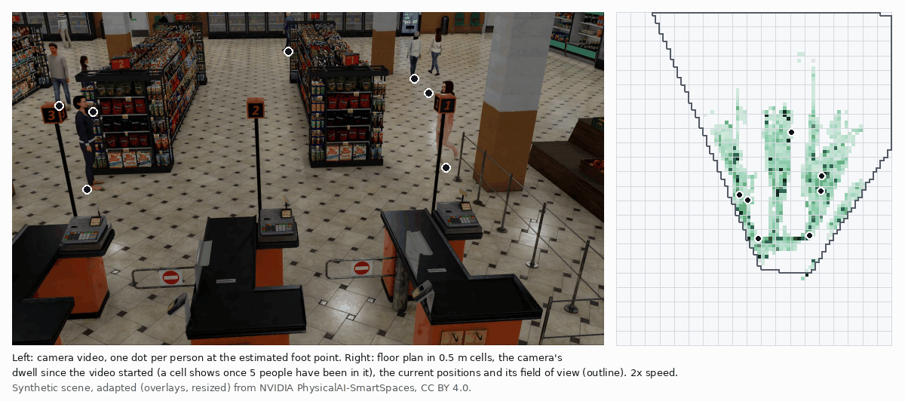

# space-usage-heatmaps

Anonymous foot-traffic and occupancy heatmaps from fixed cameras: positions on
a floor plan, never images or identities. Python, runs locally on a modest
NVIDIA GPU.



Camera 645 of scene 071 at 2x speed (`scripts/demo-gif.py`): the foot point of
each person in the image, the same positions on the floor plan, and the dwell
accumulated since the video started, shown only in cells where at least 5
distinct track ids were seen. Synthetic scene, adapted (overlays, resized) from
[NVIDIA PhysicalAI-SmartSpaces](https://huggingface.co/datasets/nvidia/PhysicalAI-SmartSpaces),
[CC BY 4.0](https://creativecommons.org/licenses/by/4.0/). The GIF is not
under this repository's Apache-2.0 licence (see [Licence](#licence)).

## What it does

For each camera, frame by frame:

1. **Detect** people with an ONNX detector (YOLOX-s by default; D-FINE-S and
   RF-DETR Nano were also evaluated) on ONNX Runtime, on CUDA or TensorRT.
2. **Track** the boxes with ByteTrack. Tracks use box geometry only, never
   appearance, and their ids are run-local counters.
3. **Place** each tracked person on the floor: a foot point is chosen per box
   and projected through the camera's floor homography. The default rule,
   "auto-track", detects boxes whose feet are hidden (by shelves or the image
   border) from the track's own height and places those feet below the head.
4. **Accumulate** two layers on a floor grid of 0.5 m cells: *dwell*
   (person-seconds per cell) and *passage* (distinct track ids that crossed a
   cell).
5. **Suppress** every cell where fewer than k=5 distinct track ids were seen,
   then **persist** only the grid, once per 15-minute slot, in SQLite.

A *site* records several cameras of one floor in one process: one shared
detector serves the cameras in turn, each camera keeps its own tracker, and
the cameras' grids are fused into one floor grid, weighted by how well each
camera sees each zone, before k=5 is applied.

A local web viewer (`space-usage serve`) shows the live layer (in memory only)
and the stored slots. `space-usage eval` scores the whole pipeline against
floor ground truth; see [Results](#results).

The code is laid out by context (perception, floorplan, occupancy,
evaluation) and layer (domain, application, infrastructure); the import rules
are in [docs/architecture.md](docs/architecture.md).

## Privacy by design

Rules R1 to R7, each checked by a test under `tests/privacy/`:

| Rule | What it guarantees |
|---|---|
| R1 | No frame or crop is ever written to disk. Images stay in memory inside perception. |
| R2 | Track ids are ephemeral, run-local counters. |
| R3 | No appearance, facial or biometric feature is computed in any module. Trackers get boxes and scores, never the image. |
| R4 | Only aggregated grids are persisted: never trajectories, per-track data or images. |
| R5 | A cell with fewer than k=5 distinct track ids reads as empty, in stored slots and in the live layer. |
| R6 | Per-camera privacy masks (polygons in the image or on the floor) drop detections before the tracker. |
| R7 | Slots older than the retention (90 days by default) are purged. |

The server binds to 127.0.0.1 unless `--host` says otherwise, and warns when it
binds beyond loopback.

### What k=5 does and does not guarantee

Both layers hide the cells where fewer than 5 distinct track ids were seen: a
slot over its quarter, the live layer over the last 2 minutes. Track ids are
not people (one person's path can be split into several ids, and foot-point
error spreads a person over neighbouring cells), so this threshold reduces but
does not guarantee anonymity at cell level. Measured on the tune scenes
(NVIDIA 071-075, every calibrated camera, against ground truth of the people a
camera has a visible box of), the share of shown cells that fewer than 5
different people crossed is 19 % for a camera's slot, 18 % for a site's fused
slot, and 58 % (camera) and 48 % (site) for the live layer over 2 minutes.
Showing a 1 m or 2 m map with k counted on its own cells was measured and not
adopted: it kept the slot rate at 14-16 %, because a coarser unit also gathers
more track ids per person, and the coarser map lost accuracy. Counting k on
1 m blocks under a 0.5 m map raised the rate to 35 % (`scripts/k-zones-sweep.py`).
Raising the threshold to 7, 10 or 15 track ids per 0.5 m cell was measured and
not adopted either: no threshold brought both slot rates to 5 % or less while
keeping the map within its accuracy guards. At 10 ids the slot rates fall to
6 % (camera) and 5 % (site), but the map hides 43 % of the true dwell instead
of 20 %, and its total variation distance to the true dwell map grows from .34
to .50 (`scripts/k-threshold-sweep.py`).

A slot also stores one total per minute for the whole grid (person-seconds and
observed seconds, table `slot_minutes`), from which the viewer reads occupancy.
That total places no one and includes the dwell of hidden cells. This is a
deliberate decision: per slot (and per minute), the whole-floor total minus the
dwell the map shows gives the total dwell inside the cells that k=5 hides, a
value with no location in it. A minute in which fewer than 5 distinct track ids
were seen stores 0 person-seconds but keeps its observed seconds.

## Requirements

- Linux on x86-64. Developed on Arch Linux; CI runs on Ubuntu.
- An NVIDIA GPU and a driver that supports CUDA 13 (R580 or later). The CUDA
  and cuDNN runtime libraries come as Python wheels, so no system CUDA toolkit
  is needed. Measured on a GTX 1650 Ti with 4 GB. Without a GPU, ONNX Runtime
  falls back to the CPU, much slower.
- [uv](https://docs.astral.sh/uv/). It installs Python 3.12 and the locked
  dependencies.
- Optional: ffmpeg and [mediamtx](https://github.com/bluenviron/mediamtx) to
  serve a video file as an RTSP stream; Node.js 22 to run the viewer's
  JavaScript tests.

Dependency groups (`uv sync` installs exactly the groups you name, plus the
default dependencies and `dev`):

| Group | Install | What for |
|---|---|---|
| default and `dev` | `uv sync` | tests, lint, and evaluation from cached tracks; no model runs |
| `runtime` | `uv sync --group runtime` | ONNX Runtime on CUDA, NVML for VRAM: needed to run a detector |
| `tensorrt` | `uv sync --group runtime --group tensorrt` | optional TensorRT speed-up for configs with `engine: onnx-trt`; without it they fall back to CUDA with a warning |
| `export` | `uv sync --group runtime --group export` | torch and the official exporters, to turn release checkpoints into ONNX files |
| `baseline` | `uv sync --group baseline` | ultralytics (AGPL-3.0), only to reproduce the iteration 0 baseline (the Ultralytics reference recipe, YOLOv8n); never needed to run the pipeline |

## Quick start

Datasets, model weights, caches and TensorRT engines live in a data
directory outside the repository. Set it before the first command (the
default is `~/datasets/space-usage-heatmaps`):

```bash
export SPACE_USAGE_DATA_DIR=~/datasets/space-usage-heatmaps
```

1. Export the detector the default config runs (YOLOX-s at a 960 input). The
   release checkpoint is downloaded from YOLOX's GitHub release, checked
   against its sha256, and exported on the CPU by YOLOX's official exporter:

   ```bash
   uv sync --group runtime --group export
   uv run --no-sync python scripts/export-detector.py yolox-s-960
   ```

2. Install the runtime:

   ```bash
   uv sync --group runtime --group tensorrt
   ```

3. Fetch NVIDIA MTMC_Tracking_2024 scenes. Each scene needs its calibration
   and ground truth, then its videos (`scripts/fetch-datasets.py` downloads
   every calibrated camera of the named scenes):

   ```bash
   base=https://huggingface.co/datasets/nvidia/PhysicalAI-SmartSpaces/resolve/main/MTMC_Tracking_2024/test
   for s in 071 072 073 074 075; do
     d="$SPACE_USAGE_DATA_DIR/nvidia/MTMC_Tracking_2024/test/scene_$s"
     mkdir -p "$d"
     for f in calibration_2025_format.json ground_truth.txt ground_truth_2025_format.json; do
       curl -fL -o "$d/$f" "$base/scene_$s/$f"
     done
   done
   uv run --no-sync python scripts/fetch-datasets.py nvidia 071 072 073 074 075
   ```

   The sealed scenes are 076 to 080. The external evaluation datasets are
   fetched the same way: `scripts/fetch-datasets.py wildtrack`, `caviar` or
   `mot17`.

4. Evaluate the default config on the tune scenes. The report is written
   under `reports/`, which the command creates:

   ```bash
   uv run --no-sync space-usage eval --config configs/h5-best.yaml --split tune
   ```

   `uv run --no-sync space-usage eval --suite e1-final` produces the full
   single-camera report (`reports/e1-final.json` and `.md`). It also compares
   against the iteration 0 baseline, which needs the `baseline` group unless
   its tracks are already cached.

5. Record one camera into 15-minute slots and open the viewer:

   ```bash
   uv run --no-sync space-usage serve --config configs/h5-best.yaml --db slots.db \
     --source "$SPACE_USAGE_DATA_DIR/nvidia/MTMC_Tracking_2024/test/scene_071/camera_0645/video.mp4"
   # open http://127.0.0.1:8000/
   ```

`scripts/verify.sh` is the repository's check: lint, format, tests and the
layer contracts. It syncs the default groups only, so run
`uv sync --group runtime --group tensorrt` afterwards to restore the runtime.

## Recording a site

A site is every camera of one floor recorded in one process into the same
15-minute slots. One TensorRT detector serves the cameras in turn; each camera
keeps its own tracker, privacy mask and floor points. When a quarter closes,
the cameras' grids are fused into one floor grid and k=5 is applied to the
fused grid. Only that grid is written, under the site id. Nothing per camera
or per track is stored.

A site config lists the cameras with their sources and calibrations, the recipe,
the stride, the floor grid and the fusion (`configs/site-071.yaml`: the 15
cameras of NVIDIA scene 071 from their video files). Relative sources and the
weights file are under the data dir. The sources are all video files (replayed
file-paced, no frame dropped) or all `rtsp://` streams (each camera keeps its
newest frame; drops reconnect with backoff and mark the slot incomplete).
Calibrations are read in NVIDIA's `calibration_2025_format.json` layout
(the config key `nvidia-mtmc/<scene>/<camera>` resolves to
`nvidia/MTMC_Tracking_2024/test/scene_<scene>/calibration_2025_format.json`
under the data dir).

```bash
# 1. Freeze the fusion weights once, from the calibration window (calibration.minutes)
uv run --no-sync space-usage calibrate --site configs/site-071.yaml
# 2. Record every camera into fused slots (Ctrl+C or SIGTERM writes the open slot)
uv run --no-sync space-usage run --site configs/site-071.yaml --db data/site-071.db --stats data/site-071-stats.json
# 3. View the fused slots; with --record, record in the same process and show the fused live layer
uv run --no-sync space-usage serve --site configs/site-071.yaml --db data/site-071.db --record
```

The weights are the evaluation's visibility weighting (power 2 on 2 m zones)
computed from what the cameras record during the calibration window (their
dwell per cell) and where they look (their floor coverage), with no ground
truth. `calibrate` refuses to overwrite them, and `run` refuses weights made
for other cameras, another grid or another fusion. To calibrate again, delete
the weights file.

The fused passage of a cell is the weighted mean of the covering cameras'
distinct track ids, so a cell shows only where at least one camera saw 5 or
more distinct track ids. A slot's minute totals are the cameras' per-minute
dwell fused with the same weights, using in each minute only the cameras that
covered it (weights renormalised per cell over them); its observed seconds per
minute are the most any one camera covered. The page shows the fused live
layer and slots, their occupancy, the fusion, and each camera's state and
processed frame rate.

## Live viewer and API

`space-usage serve` hosts a page with the floor-plan heatmap of one camera or
one site: the live layer (60 s half-life, held in memory only) updating every
second, and the persisted 15-minute slots. With `--source` it records that
camera in the same process, so the live layer never leaves memory; without it,
it opens on the newest stored slot and never asks for a live layer.

A slot reads as occupancy, never as a count of ids: people in view on average
(the slot's recorded dwell over the seconds the source covered) and the peak
1-minute occupancy, both from the per-minute totals described under
[Privacy by design](#privacy-by-design). A minute with fewer than 5 distinct
track ids counts as 0 in the mean. A slot recorded before `slot_minutes`
existed has no reading. With one camera, people hidden from it are not
counted, so it usually reads low where the view is occluded, yet some cameras
read above the truth; the page reads "about N people in view on average",
never a bound. On the held-out scenes a single camera's average was off by
14.5 % at the median (absolute error); the 15-camera site of scene 071 (tune)
read 3.6 % below
([docs/results.md](docs/results.md#occupancy-reading)). Passage reads in
crossings: the distinct track ids that crossed a cell, a relative measure of
foot traffic, not a number of people. Beside the map (below it on a phone) a
table ranks the top 10 of the grid's 2 m zones by dwell, with their
coordinates; a stored map is cropped to its observed extent plus 2 m.

```bash
uv run --no-sync space-usage serve --config configs/h5-best.yaml --db slots.db \
  --source rtsp://127.0.0.1:8554/s071 --port 8000
# open http://127.0.0.1:8000/
```

API:

- `GET /api/live?camera=` returns `{cell_m, origin, shape, dwell, passage, t, ended}`,
  or 503 once the recorder has failed.
- `GET /api/slots?camera=&from=&to=` returns the slots starting in
  `[from, to)` (ISO 8601 with a zone, or epoch seconds, clamped to 1970 to
  2100), k-suppressed as they are stored, each with `mean_occupancy`,
  `peak_occupancy`, `peak_start` and `observed_s`.

### A local RTSP stream from a video file

`scripts/rtsp-loop.sh` serves a file in a loop with
[mediamtx](https://github.com/bluenviron/mediamtx) (MIT, not a dependency) and
ffmpeg. Download the `linux_amd64` release and its `checksums.sha256`, check it,
then:

```bash
grep linux_amd64 checksums.sha256 | sha256sum -c -
tar -xzf mediamtx_v*_linux_amd64.tar.gz -C ~/tools/mediamtx
MEDIAMTX=~/tools/mediamtx/mediamtx scripts/rtsp-loop.sh \
  "$SPACE_USAGE_DATA_DIR/nvidia/MTMC_Tracking_2024/test/scene_071/camera_0645/video.mp4" s071
# -> rtsp://127.0.0.1:8554/s071 until Ctrl+C
```

## Results

Measured on NVIDIA MTMC_Tracking_2024 against floor ground truth, with
`configs/h5-best.yaml` (YOLOX-s at 960 on TensorRT fp16, ByteTrack, the
auto-track foot point). Every parameter was chosen on the *tune* scenes
(071 to 075); the *sealed* scenes (076 to 080) were held out and scored once,
at the end. Dwell maps on 0.5 m cells.

| Measure | Result | Target |
|---|---|---|
| One camera, dwell map TVD (tune / sealed) | 0.308 / 0.419 | ≤ 0.30 |
| One camera, mass error (tune / sealed) | 0.154 / 0.297 | ≤ 0.10 |
| Ground position error, WILDTRACK C5 (never tuned on) | median 21.8 cm, p90 45.1 cm | median ≤ 30 cm |
| Speed, one 1080p camera, GTX 1650 Ti | 42.5 fps mean, 174 MB VRAM | ≥ 15 fps, ≤ 3.5 GB |
| Cameras per GTX 1650 Ti at stride 10 | 8 (15 do not fit) | – |
| Occupancy, one camera, sealed (median absolute error) | 14.5 % | – |

The single-camera targets are missed on the sealed scenes. The confidence
intervals, each accepted step, the external datasets (WILDTRACK, CAVIAR,
MOT17), the label-free metrics and the terms used in code comments (E1, H1,
iteration 0, tune and sealed) are in [docs/results.md](docs/results.md).
Every hypothesis, the rule fixed before its run, and the decision, rejected
ones included, are in [docs/experiment-log.md](docs/experiment-log.md).

## Limitations

- **Occlusion and single cameras.** One camera does not see people behind
  shelves: against every person on the floor, TVD is 0.450 on tune and 0.557
  on sealed. Fusing the cameras of a floor covers part of that gap; a single
  camera's occupancy reads low where its view is occluded.
- **The single-camera targets are missed on the sealed scenes.** TVD 0.419
  against a target of 0.30, and more than the allowed 20 % degradation from
  tune. The baseline degrades on the same scenes, so they are harder, but the
  tuned recipe does not generalise as well as planned.
- **Synthetic scenes.** Tuning and the main evaluation use NVIDIA's synthetic
  indoor scenes. Real footage was only scored on the external datasets
  (WILDTRACK, CAVIAR, MOT17), never on a deployed site.
- **k=5 is not anonymity.** Up to 19 % of shown slot cells, and up to 58 % of
  live cells, were crossed by fewer than 5 different people (see
  [What k=5 does and does not guarantee](#what-k5-does-and-does-not-guarantee)).
- **Calibration format.** Cameras are calibrated through NVIDIA's calibration
  layout; there is no calibration tool for a new site yet.
- **Hardware.** Measured on one GPU (GTX 1650 Ti, 4 GB) and on Linux only.

## Datasets and licences

No dataset is redistributed here; each one is fetched from its official
source into the data directory and used to measure only. The run path takes
Apache-2.0, MIT or BSD code and weights only. Every dependency, model weight
and dataset, with its licence, is listed in
[docs/licenses.md](docs/licenses.md).

| Dataset | Licence | Use |
|---|---|---|
| NVIDIA PhysicalAI-SmartSpaces, MTMC_Tracking_2024 | CC BY 4.0 | tuning and evaluation; the demo GIF |
| WILDTRACK (EPFL CVLab) | no licence stated; research use | evaluation only |
| CAVIAR | CC BY-SA | evaluation only |
| MOT17 | CC BY-NC-SA 3.0 | evaluation only |

## Licence

The code and documentation are licensed under the
[Apache License 2.0](LICENSE). See [NOTICE](NOTICE).

Exceptions and optional parts:

- `docs/media/demo.gif` is not under Apache-2.0. It is adapted (overlays,
  resized) from [NVIDIA PhysicalAI-SmartSpaces](https://huggingface.co/datasets/nvidia/PhysicalAI-SmartSpaces)
  and distributed under [CC BY 4.0](https://creativecommons.org/licenses/by/4.0/).
- The optional `baseline` group installs ultralytics, which is AGPL-3.0. It is
  used for evaluation only (the iteration 0 baseline), imported only under
  `src/space_usage_heatmaps/evaluation/baseline/`, never installed by CI and
  never needed to run the pipeline.
- The optional `tensorrt` group installs NVIDIA's TensorRT libraries under
  NVIDIA's proprietary licence, from NVIDIA's own index. They are not
  redistributed here, and the pipeline runs without them.

## Acknowledgements and citation

The evaluation data is NVIDIA's PhysicalAI-SmartSpaces dataset. Its dataset
card asks users to cite these papers:

```bibtex
@InProceedings{Wang26PAISS,
author = {Yuxing Wang and Yizhou Wang and Anqi Li and Shuo Wang and Sameer Satish Pusegaonkar and Haoquan Liang and Jiajun Li and Shenxin Jiang and Jianhe Yuan and Shangru Li and Tongwei Dai and Zihao Chen and David C. Anastasiu and Sujit Biswas and Xunlei Wu and Zheng Tang},
title = {Physical {AI} {S}mart {S}paces: {A} large-scale benchmark for multi-camera {3D} perception in smart spaces},
booktitle = {Proc. NeurIPS},
address = {Atlanta, GA, USA},
note = {arXiv:2610.02580},
year = {2026}
}

@misc{Wang26Unified3DPerception,
author = {Yizhou Wang and Sameer Pusegaonkar and Yuxing Wang and Anqi Li and Vishal Kumar and Chetan Sethi and Ganapathy Aiyer and Yun He and Kartikay Thakkar and Swapnil Rathi and Bhushan Rupde and Zheng Tang and Sujit Biswas},
title = {A unified {3D} object perception framework for real-time outside-in multi-camera systems},
note = {arXiv:2601.10819},
year = {2026}
}

@InProceedings{Tang26AICity26,
author = {Zheng Tang and Shuo Wang and David C. Anastasiu and Ming-Ching Chang and Anuj Sharma and Quan Kong and Munkhjargal Gochoo and Jun-Wei Hsieh and Tomasz Kornuta and Zhedong Zheng and Renran Tian and Judah Goldfeder and Fulgencio Navarro and Yuxing Wang and Yizhou Wang and Sameer Satish Pusegaonkar and Anqi Li and Nalin Dadhich and Ridham Kachhadiya and Dhanishtha Patil and Haoquan Liang and Jiajun Li and Han Zhang and Yilin Zhao and Zaid Pervaiz Bhat and Shuyu Yang and Ashutosh Kumar and Rong Wang and Rafael Martin Nieto and Peter Christiansen and Ahmed Abduljawad and Mohanrasu Shanmugam and Nadeem Shaik and Sujit Biswas and Xunlei Wu and Vidya Murali and Rama Chellappa},
title = {The 10th {AI} {C}ity {C}hallenge},
booktitle = {Proc. ECCV Workshops},
address = {Malm\"o, Sweden},
year = {2026}
}

@InProceedings{Tang25AICity25,
author = {Zheng Tang and Shuo Wang and David C. Anastasiu and Ming-Ching Chang and Anuj Sharma and Quan Kong and Norimasa Kobori and Munkhjargal Gochoo and Ganzorig Batnasan and Munkh-Erdene Otgonbold and Fady Alnajjar and Jun-Wei Hsieh and Tomasz Kornuta and Xiaolong Li and Yilin Zhao and Han Zhang and Subhashree Radhakrishnan and Arihant Jain and Ratnesh Kumar and Vidya N. Murali and Yuxing Wang and Sameer Satish Pusegaonkar and Yizhou Wang and Sujit Biswas and Xunlei Wu and Zhedong Zheng and Pranamesh Chakraborty and Rama Chellappa},
title = {The 9th {AI} {C}ity {C}hallenge},
booktitle = {Proc. ICCV Workshops},
pages = {5526–-5535},
address = {Honolulu, HI, USA},
year = {2025}
}

@inproceedings{Wang24AICity24,
author = {Shuo Wang and David C. Anastasiu and Zheng Tang and Ming-Ching Chang and Yue Yao and Liang Zheng and Mohammed Shaiqur Rahman and Meenakshi S. Arya and Anuj Sharma and Pranamesh Chakraborty and Sanjita Prajapati and Quan Kong and Norimasa Kobori and Munkhjargal Gochoo and Munkh-Erdene Otgonbold and Ganzorig Batnasan and Fady Alnajjar and Ping-Yang Chen and Jun-Wei Hsieh and Xunlei Wu and Sameer Satish Pusegaonkar and Yizhou Wang and Sujit Biswas and Rama Chellappa},
title = {The 8th {AI} {C}ity {C}hallenge},
booktitle = {Proc. CVPR Workshops},
pages = {7261--7272},
address = {Seattle, WA, USA},
year = {2024}
}
```

Methods and software this work builds on:

- **YOLOX**: Z. Ge, S. Liu, F. Wang, Z. Li, J. Sun, "YOLOX: Exceeding YOLO
  Series in 2021", arXiv:2107.08430. The default detector, from Megvii's
  Apache-2.0 release and exporter.
- **ByteTrack**: Y. Zhang et al., "ByteTrack: Multi-Object Tracking by
  Associating Every Detection Box", ECCV 2022. Used through Roboflow's
  [trackers](https://github.com/roboflow/trackers) (Apache-2.0), which also
  provides OC-SORT and a port of TrackEval's HOTA and IDF1.
- **UCMCTrack**: K. Yi et al., "UCMCTrack: Multi-Object Tracking with Uniform
  Camera Motion Compensation", AAAI 2024. The floor-plane tracker in
  `src/space_usage_heatmaps/perception/infrastructure/ucmc_tracker.py` is an
  independent implementation after [its MIT code](https://github.com/corfyi/UCMCTrack).
- **D-FINE** and **RF-DETR**, evaluated as alternative detectors (Apache-2.0
  weights).
- **WILDTRACK**: T. Chavdarova et al., CVPR 2018. **CAVIAR**: the EC-funded
  CAVIAR project IST 2001 37540. **MOT17**: the MOTChallenge benchmark.
